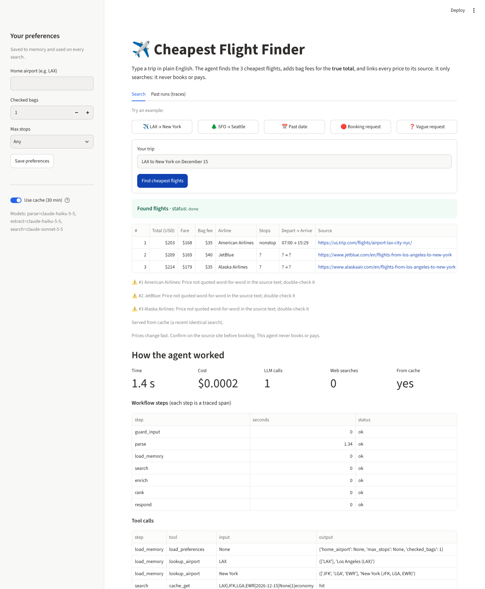

# ✈️ Cheapest Flight Finder Agent

An AI agent that finds the **3 cheapest flights** for a trip, adds **checked-bag fees** to show the
**true total cost**, flags risky itineraries, and links every price to its source.
It only searches. It never books or pays.

```
$ python -m flight_agent "LAX to New York on December 15"
```

Or use the web page: `streamlit run app.py`. **New here? Read [docs/DEMO-GUIDE.md](docs/DEMO-GUIDE.md)** (plain language).



## The problem

Finding a cheap flight means checking several sites, then discovering bag fees and basic-economy
restrictions late. That costs 30–60 minutes per trip, and the "cheapest" fare is often not the cheapest
once a suitcase is added.

**User:** a budget traveller who wants an answer in under a minute, with sources they can trust.

**Why an agent and not a script?** Requests are messy ("cheap flight to London next month"), the
search needs judgement across sources, and results must be checked and enriched with fee rules. Fixed
code can't read free text or search pages; an LLM can't be trusted alone with prices. The agent
combines both: **LLM for understanding and searching, plain code for validating and ranking.**

## Architecture

```
user text
   │
   ▼
1. guard_input ── refuse: booking/payment, card numbers, prompt injection, too long
   │
   ▼
2. parse ──────── Claude Haiku 5.5 + structured output → ParsedTrip (dates resolved)
   │
   ▼
3. load_memory ── saved preferences (home airport, bags, max stops) fill gaps
   │              airport tool → codes (NYC → JFK, LGA, EWR); date checks
   │              missing info → ask a clarifying question (max 2)
   ▼
4. search ─────── cache hit? → reuse
   │              Claude Sonnet 5.5 + web search (≥2 sources) → notes + URLs
   │              Haiku extracts flight records → guardrails validate each one
   │              fallback chain: retry other sources → stale cache → honest "no results"
   ▼
5. enrich (RAG) ─ airline knowledge base → bag fee → true total = fare + bags
   ▼
6. rank ───────── de-duplicate, sort by true total, keep top 3
   ▼
7. respond ────── table + warnings + sources + disclaimer (output guardrail)

Every step runs inside a tracing span → traces/<trace_id>.json
```

**One shared state object** (`AgentState` in `flight_agent/state.py`) is passed through the steps.
**No endless loops:** each step runs once, the run is capped at 12 steps and 120 seconds, search retries
at most once, web search is capped at 6 queries per call, and clarifying questions at 2.

### Design decisions

| Decision | Why |
|---|---|
| Fixed workflow, not a free-roaming agent | Predictable, testable and traceable; the LLM only does what needs judgement |
| Cheap model (Haiku) for parsing and extraction, stronger model (Sonnet) for web research | Cuts cost on the simple steps |
| Prices validated by code, not by the LLM | A price is kept only if its link came from the actual search results and the route and date match, which stops invented prices |
| RAG for bag fees | Fee rules are long, change often and differ per airline; retrieval with citations beats stuffing them into the prompt |
| Search only, never book | Safety and scope |

## How the course criteria are covered

| Criterion | Where |
|---|---|
| 1. Problem & design | This README: problem, user, architecture, decisions |
| 2. Orchestration | `flight_agent/agent.py`: 7 steps, shared `AgentState`, preferences memory, step/time/retry limits |
| 3. Tools | Claude web search, airport lookup (`airports.py`), bag-fee RAG (`rag/`), currency conversion and cache (`store.py`) |
| 4. RAG | `knowledge/*.md` + `rag/retriever.py`: section chunking, query rewriting (synonyms), airline metadata filter, BM25 ranking, citations |
| 5. Observability | `tracing.py`: per-run trace with spans, every LLM call (full prompt, response, tokens, cost), every tool call; sample traces in `traces/examples/`; trace viewer in the web UI |
| 6. Evaluation | `evals/`: 15-case dataset, automatic scoring, v1 vs v2 comparison with a regression gate; `tests/`: 33 tests run in CI |
| 7. Guardrails | `guardrails.py`: input checks, web-text sanitising, offer validation, output check; refusal fallback model; fallback chain |
| 8. Performance & cost | Cost and latency measured per run; 30-minute cache; Haiku on cheap steps; prompt caching on the search prompt |
| 9. Production | Modular package, `config.yaml`, env-var secrets, `Dockerfile`, GitHub Actions CI, web UI (`app.py`) |
| 10. Demo | Web UI + [demo script](docs/DEMO-GUIDE.md) |

## Run it

**1. Add your API key** as an environment variable named `FLIGHT_AGENT_API_KEY`
(`ANTHROPIC_API_KEY` also works locally). Never commit it.
In a Claude Code cloud session, add it in the environment settings as `FLIGHT_AGENT_API_KEY`:
cloud sessions reserve `ANTHROPIC_*` names for Claude Code itself. Locally:

```bash
export FLIGHT_AGENT_API_KEY=your-key-here
```

Or, easier: copy `.env.example` to a file named `.env` in the project folder and put your key in it.
The agent reads it automatically, and git ignores `.env`, so the key is never uploaded.

**2. Install**

```bash
pip install -r requirements.txt
```

**Check the key works** (free: it only lists models, no tokens used)

```bash
python -m flight_agent --check-key
```

**3. Search**

```bash
python -m flight_agent "LAX to New York on December 15"
```

**Web UI** (the easiest way to demo)

```bash
streamlit run app.py
```

Opens http://localhost:8501: search box, example buttons (including the tricky inputs), preferences,
results with bag fees and sources, and a "How the agent worked" panel (steps, tool calls, model calls,
time, cost, full trace). A "Past runs" tab lists every trace.

**Demo video from a cloud session** (where localhost isn't reachable): start the app with
`streamlit run app.py --server.headless true`, then run `node demo/record_demo.js`.
It saves a captioned walkthrough to `demo/output/demo.webm` (about $0.08).

**Preferences (memory)**

```bash
python -m flight_agent --set home_airport=SFO --set checked_bags=1 --set max_stops=1
```

```bash
python -m flight_agent "from my usual airport to Seattle on December 20"
```

**Tests** (free, using a fake LLM)

```bash
python -m pytest -q
```

**Evals** (real API calls). The default quick set has 8 cases and costs about $0.50: 4 flight searches
(domestic, international, bag fee, memory) and 4 behaviour checks (vague, past date, booking, injection).
Evals use 3 web searches per search and no retry, and stop if a run spends more than $1.50
(see `evals:` in `config.yaml`). Add `--all` for all 15 cases (about $1.50).

```bash
python -m evals.run_evals --version v1
```

```bash
python -m evals.compare v1 v2
```

**Docker**

```bash
docker build -t flight-agent .
```

```bash
docker run -e FLIGHT_AGENT_API_KEY flight-agent "LAX to New York on December 15"
```

## Results

Automatic evals on the 8-case quick set (4 flight searches + vague, past date, booking, injection),
run live on Nov 24 2026 with eval limits (3 web searches, no retry). Full details:
`evals/results/v1.md`, `v2.md`, `v3.md` and `compare_v1_v3.md`.

| Metric | v1 | v2 | v3 |
|---|---|---|---|
| Pass rate (8 cases) | 75% | 88% | 100% |
| Right behaviour (search / ask / refuse) | 75% | 100% | 100% |
| Route accuracy | 75% | 100% | 100% |
| Search cases with results | 50% | 100% | 100% |
| Every price has a source link | 50% | 100% | 100% |
| Bag fee added (RAG case) | 0% | 0% | 100% |
| Offers dropped by guardrails | 0 | 0 | 4 |
| Avg cost per search case | $0.032 | $0.051 | $0.042 |
| Median seconds per search case | 18 s | 27 s | 29 s |
| Total cost of the eval run | $0.128 | $0.203 | $0.170 |

**What changed between versions (each fix found by the eval, with a test added):**

| Version | Failure the eval found | Fix |
|---|---|---|
| v1 → v2 | **mem-01:** "from my usual airport" asked a question: the model filled in "Seattle" but also listed it as missing | Code trusts filled-in fields over the model's "missing" list |
| v1 → v2 | **fee-01:** Denver → Las Vegas gave no results: only route-wide "from $52" prices existed | Prompt v2 allows them, labelled `from-price`, with a "not confirmed for your date" warning |
| v2 → v3 | **fee-01:** the v2 fix let in travel-site prices with **no airline** ("not specified"): no bag fee possible, nothing to book | New guardrail drops offers without a named airline |

A first v2 run (`v2-rate-limited.md`) failed 2 searches because the web-search tool returned a
"server tool use limit exceeded" error. The agent reported "no results" honestly instead of inventing
prices. Traces now record web-search error codes (`search_errors`) so this is easy to spot.

**Honest caveats:** these are single runs of 8 cases and web search varies between runs, so treat
the numbers as evidence, not a guarantee. "Price quoted word-for-word in the source" stayed at 0%:
search snippets rarely quote the price exactly, so every price carries a "double-check" warning.
v3 is slower and a little more expensive per search ($0.042 vs $0.032) because it now finds and
checks more offers.

**Manual check:** for 3 trips, the agent's cheapest price compared with Google Flights: _to fill in_.

**Measured (live, Nov 24 2026):** LAX → New York fresh search 27.1 s, $0.065 (4 web searches);
the same trip from cache 1.1 s, $0.0002. Refusals cost $0–0.0002 and take about 1 s. Traces in `traces/examples/`.

## Limitations (honest list)

- Prices come from web search results, not a booking API, so some sites hide prices from search and results can be incomplete.
- Many prices come from airline route pages ("from $179"), so times and stops are often unknown and prices are flagged "double-check".
- Bag fees in `knowledge/` are based on published 2025 policies and are **not re-verified**. Budget airlines price bags dynamically. Always check the airline's page.
- The airport list covers about 80 major airports.
- Currency rates in `config.yaml` are fixed approximations.

## Next steps

A real flight-price API, flexible dates (±3 days), price-drop alerts, an MCP server for the tools, a hosted web UI,
a hosted tracing tool (Langfuse), an LLM-as-judge for answer quality, and live refresh of the bag-fee knowledge base.

## Demo

Script with timings: [docs/DEMO-GUIDE.md](docs/DEMO-GUIDE.md). A 3-minute live demo that shows:
1. The problem
2. A live run with a suitcase preference
3. A trace file
4. The v1 vs v2 eval comparison
5. Next steps
